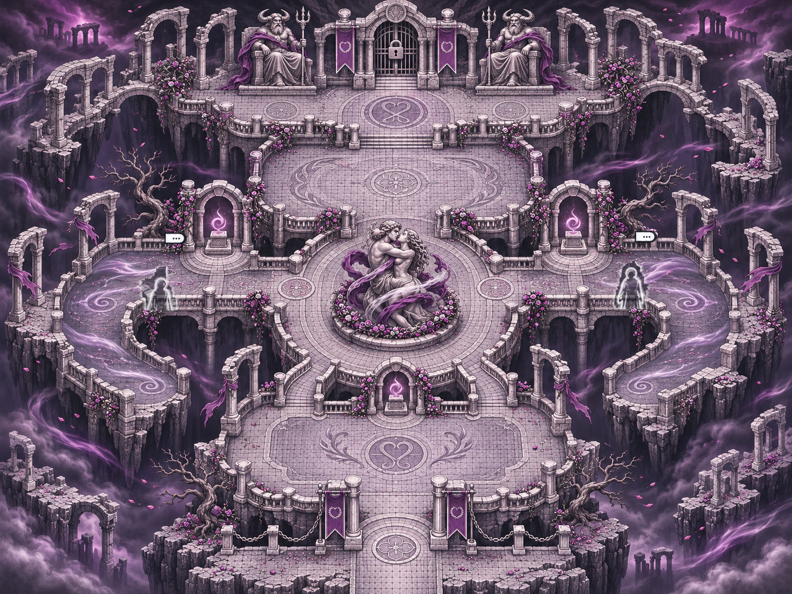

# Diseño de un entorno virtual: Lujuria

**Videojuego:** INFERNO: EL DESCENSO  
**Entorno elegido para la evaluación:** Lujuria, segundo círculo del juego.

Esta entrega presenta **un solo escenario**. Dante llega a Lujuria durante su descenso por el Infierno. Para abrir el umbral del norte debe explorar el mapa, activar tres sellos, escuchar a dos almas y superar el combate contra Minos.

## 1. Coherencia con el videojuego — 4 puntos

Lujuria representa un círculo donde las almas son arrastradas por una tempestad. Por eso el **viento afecta el movimiento** y forma parte del desafío, además de la ambientación. Dante mantiene las acciones de exploración e interacción del juego; aquí también debe combatir para avanzar.

Los tres sellos se activan en el orden **Memoria → Aliento → Juicio** y debilitan el viento. Los diálogos con **Paolo y Francesca** presentan decisiones de **Redención o Rigor**, que se conservan en el progreso del jugador. **Minos**, el juez del círculo, custodia la salida. Así, historia, objetivos y mecánicas ocurren dentro del mismo espacio.

## 2. Diseño visual y ambientación — 4 puntos

El mapa 2D se organiza desde la **entrada al sur** hasta la **puerta al norte**. Una plaza central conecta dos zonas laterales y un patio superior. La escultura de la pareja en el centro es el punto de referencia visual; los arcos, estatuas y la puerta marcan el avance hacia Minos.

La paleta combina **violetas**, piedra gris y sombras oscuras. Las ruinas suspendidas sobre el vacío, las flores y los estandartes construyen un lugar bello e inquietante. Las ráfagas y el sonido ambiental hacen perceptible la tormenta. Los sellos destacan como puntos de interés y la interfaz muestra objetivos, diálogo, minimapa y, durante la pelea final, la salud de Minos.

## 3. Elementos y objetos del entorno — 4 puntos

| Elemento | Tipo | Función dentro del escenario |
| --- | --- | --- |
| Dante | Personaje jugable | Explora, esquiva, interactúa y combate. |
| Virgilio | Guía interactivo | Explica el círculo y da pistas para continuar. |
| Sellos de Memoria, Aliento y Juicio | Objetos interactivos | Forman el objetivo de exploración; se activan en orden y debilitan el viento. |
| Paolo y Francesca | Almas interactivas | Presentan diálogos y decisiones de Redención o Rigor. |
| Demonios y espectros | Enemigos | Aparecen en zonas del recorrido y dificultan llegar a los sellos. |
| Minos | Jefe final | Protege el acceso a la puerta norte. |
| Puerta norte | Meta interactiva | Permite completar el escenario después de derrotar a Minos. |
| Viento, abismos, bordes y escultura central | Peligros y obstáculos | Modifican el desplazamiento y obligan a elegir rutas seguras. |
| Arcos, balcones, estatuas, flores y estandartes | Decoración | Refuerzan el tema del círculo y ayudan a reconocer las zonas. |

## 4. Funcionalidad e interacción — 4 puntos

**Ruta principal sugerida:** entrada sur → sello de Memoria → zona izquierda y sello del Aliento → zona derecha y sello del Juicio → Paolo y Francesca → patio superior → Minos → puerta norte. El jugador puede explorar las plazas y conversar con las almas en otro momento, pero los **sellos sí tienen un orden obligatorio**.

Las plazas laterales son zonas de exploración con ráfagas y enemigos. Los bordes de los balcones y los abismos impiden cruzar fuera de los caminos; la escultura central obliga a rodearla. Cerca de un sello, los enemigos deben dejar de ser una amenaza inmediata antes de activarlo. Tras activar sellos, la fuerza del viento baja, de modo que la interacción modifica el entorno y facilita el avance.

El patio superior sirve de antesala del combate final. Minos aparece cuando están activos los tres sellos, se han tomado las dos decisiones y se ha superado el encuentro del patio. La puerta permanece cerrada mientras Minos la custodia.

**Controles para mostrar en clase:** WASD o flechas para moverse; **E** para interactuar; **Q** para pedir una pista; **Espacio** para esquivar; **J** para ataque cercano; **K** para verso de luz; **1/2** o clic para elegir en los diálogos.

## 5. Presentación y justificación grupal — 4 puntos

### Guion breve para exponer

1. «Elegimos Lujuria como el entorno virtual que vamos a evaluar. Dante debe atravesar una tempestad y abrir la puerta que protege Minos».
2. «Usamos tonos violetas, ruinas sobre el vacío y una escultura central para mostrar la identidad del círculo y orientar al jugador».
3. «El mapa conduce desde el sur hacia el norte, pero invita a visitar las plazas laterales. El viento, los bordes y los enemigos hacen que la ruta importe».
4. «Los tres sellos son objetivos interactivos: se activan en orden y reducen el viento. Paolo y Francesca conectan el recorrido con las decisiones de Redención y Rigor».
5. «El patio superior prepara el combate contra Minos. Al vencerlo se libera la salida; por eso los elementos visuales y los objetos tienen una función en la jugabilidad».

### Participación del grupo

Completen esta tabla con los **aportes reales** antes de entregar. Cada integrante debe explicar su parte y señalarla en el mapa o durante la demostración.

| Integrante | Aporte realizado | Parte que explicará |
| --- | --- | --- |
| [Nombre 1] | [Aporte real] | [Parte] |
| [Nombre 2] | [Aporte real] | [Parte] |
| [Nombre 3] | [Aporte real] | [Parte] |
| [Nombre 4] | [Aporte real] | [Parte] |

## Evidencias para la entrega

- Una captura de **Lujuria abierta en Godot**, con Dante y la interfaz visibles.
- Una copia del mapa con flechas y rótulos: entrada sur, los tres sellos, plazas laterales, Paolo, Francesca, patio, Minos, obstáculos y puerta norte.
- Una demostración breve del viento, un sello, una conversación con decisión y un encuentro enemigo. Si hay tiempo, mostrar la puerta bloqueada antes de vencer a Minos.

**Alcance del prototipo:** la puerta se llama «Umbral hacia la Gula», pero el escenario evaluado y jugable en esta entrega es Lujuria.
